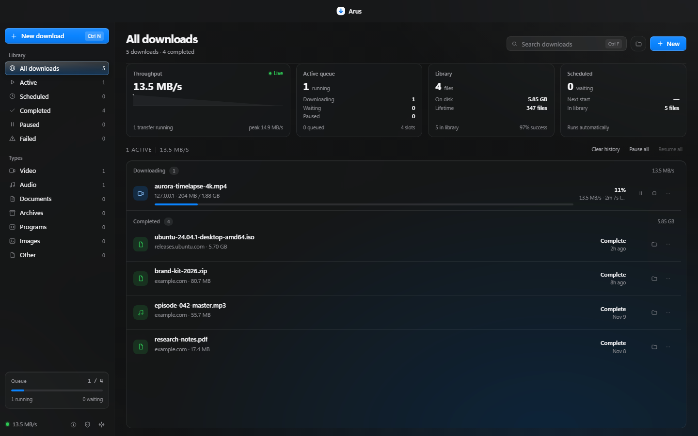

# Arus

Download manager untuk Windows. Dibangun dengan Rust dan Tauri, memakai WebView2 yang sudah ada di sistem.



## Unduh

Installer terbaru ada di halaman [Releases](https://github.com/arielbudinex-oss/Arus-Download-Manager/releases/latest). Untuk Windows 10 dan 11, 64-bit. Tidak perlu akun.

Situs: https://arus.xinet.id/

## Fitur

- Beberapa koneksi per file. Default 16, bisa diatur antara 1 sampai 32.
- HLS dan DASH: segmen diunduh terpisah lalu digabung dengan ffmpeg.
- Antrean, jadwal unduhan, dan prioritas.
- Batas kecepatan global atau per unduhan.
- Verifikasi SHA-256 setelah file selesai.
- Clipboard watch: salin satu tautan, Arus menawarkan untuk mengunduhnya.
- Ekstensi Chromium untuk menangkap media dan menggantikan unduhan browser, dengan panduan sekali jalan saat Arus pertama dibuka.
- Tray, notifikasi, dan popup progres yang singkat.
- Pengecekan rilis di GitHub yang bisa dimatikan, plus dukungan QRIS di dalam aplikasi.
- Laporan bug manual dari Settings, About. Log terakhir ikut dikirim setelah link, path folder, dan token URL dibersihkan. Tidak ada laporan otomatis.
- Tanpa telemetri otomatis, tanpa iklan, tanpa langganan.

## Kenapa kecil

Arus tidak membawa browser sendiri. Antarmuka memakai WebView2 bawaan Windows, sedangkan engine unduhan berjalan di Rust. Data ditulis ke disk per bagian, jadi mengunduh file besar tidak ikut membesarkan pemakaian RAM.

Angka dari rilis 1.0.1 di Windows 11:

| Aspek | Arus |
| --- | --- |
| Installer | 3,5 MB |
| RAM saat idle | sekitar 19 MB |
| Runtime | Rust + WebView2 |
| Telemetri otomatis | tidak ada |

## Ekstensi browser

Saat Arus pertama dibuka, panduan pemasangan muncul sekali. Tombol di sana membuka halaman ekstensi di browser default dan menyalin path folder ekstensi. Browser tidak mengizinkan pemasangan senyap, jadi langkah Load unpacked tetap dilakukan sekali oleh pengguna.

Kalau ingin memasang manual:

1. Buka `chrome://extensions` (atau halaman ekstensi di Edge/Brave).
2. Aktifkan Developer mode.
3. Pilih Load unpacked, arahkan ke folder `extension/` di repo ini.

Ekstensi menghubungi Arus di `127.0.0.1:4477`. Kalau Arus belum berjalan, ekstensi akan mencoba membukanya. Setelah ekstensi terpasang, Arus mendeteksinya sendiri dan menampilkan status Connected di Settings, lalu Capture.

## Build dari source

Prasyarat:

- Windows 10/11 64-bit dengan WebView2 (Windows 11 sudah terpasang).
- Rust stable dengan toolchain MSVC.
- Microsoft C++ Build Tools.
- Node.js 20 atau lebih baru untuk Tauri CLI.

Jalankan dari folder `rust-native`:

```powershell
npx @tauri-apps/cli build --bundles nsis
```

Installer muncul di `rust-native/target/release/bundle/nsis/`. Folder `public/`, `assets/`, dan `extension/` ikut dibundel sebagai resource karena aplikasi menyajikannya lewat server lokal.

Untuk menjalankan versi development:

```powershell
cd rust-native
cargo run
```

## Situs dan laporan bug

Folder `site/` berisi situs promosi sekaligus endpoint laporan. Deploy dari dalam folder itu, bukan dari akar repo, supaya Vercel menyajikan halaman promosi:

```powershell
cd site
vercel deploy --prod
```

Endpoint yang dipakai:

- `POST /api/report` menerima laporan dari aplikasi. Isinya deskripsi, kontak opsional, versi aplikasi, ringkasan diagnostik, dan log terakhir. Laporan disimpan sebagai blob privat.
- `GET /api/reports` hanya untuk pemilik, memakai header `x-reports-key` yang dicocokkan dengan env `REPORTS_KEY`.
- Halaman `/admin` adalah dasbor laporan. Kunci dimasukkan saat membuka halaman dan tidak ikut disimpan ke server.

Penyimpanan memakai Vercel Blob lewat env `BLOB_READ_WRITE_TOKEN`. Tidak ada laporan yang dikirim tanpa tindakan pengguna.

## Batasan

- Khusus Windows 10/11 64-bit.
- YouTube dan stream yang dilindungi tidak didukung. Arus tidak mengekstrak signature atau memotong proteksi situs.
- Penggabungan HLS/DASH membutuhkan ffmpeg di PATH. Kalau tidak ada, Arus memberi tahu saat dibutuhkan.
- Installer belum ditandatangani dengan sertifikat code signing, jadi Windows SmartScreen bisa menampilkan peringatan saat pertama kali dibuka.

## Dukung pengembangan

Arus gratis dan tidak punya fitur berbayar. Kalau berguna, kamu bisa memberi dukungan lewat QRIS dengan nominal bebas di halaman [Dukungan](https://arus.xinet.id/#dukungan) atau dari tombol Support Arus di aplikasi. Pembayaran diproses aplikasi bank atau e-wallet kamu.

## Komunitas

- Discord: https://discord.gg/K84ebNFJV
- Bug dan usulan: [Issues](https://github.com/arielbudinex-oss/Arus-Download-Manager/issues)

## Lisensi

MIT. Lihat [LICENSE](LICENSE). Komponen pihak ketiga tercatat di [THIRD_PARTY_NOTICES.md](THIRD_PARTY_NOTICES.md).
